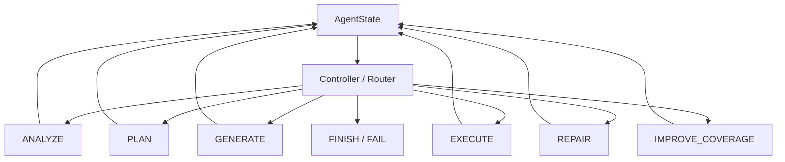

# TestPilot

## 项目简介

TestPilot 是《软件工程与项目实践》Homework 1 开发的 **Project-aware Test Generation Agent**，面向中小型 Python 项目。它结合仓库扫描与 AST 分析、DeepSeek 测试规划和生成、pytest/coverage 执行反馈，自动开展失败修复与覆盖率补测，并输出可审查的运行报告。

核心流程：**项目分析 → 上下文选择 → 测试规划与生成 → Docker / Local 执行 → Repair / Coverage Improvement → 最终报告**。系统通过 LangGraph 管理状态、调用工具并根据执行结果决定下一步，而非一次性的 LLM 测试生成脚本。实现与设计取舍详见 [Design.md](Design.md)。

## 演示视频

[▶ 查看 TestPilot 演示视频](TestPilot_Demo.mp4)

## 核心功能

- **项目感知**：递归扫描 Python 文件，基于 AST 提取函数、类、签名及直接内部依赖，按模块选择跨文件上下文。
- **测试生成**：由 DeepSeek 规划并生成正常、边界、异常、无效输入、分支及交互场景；通过参数化与保守去重降低冗余，不设置固定用例数量上限。
- **双反馈闭环**：依据 pytest traceback 进行有界 Repair，依据缺失行/分支进行有界 Coverage Improvement；每轮修改后重新执行。
- **受控执行**：优先使用 Docker 隔离运行，支持 LocalRunner 与可配置的 Docker 不可用时回退。
- **可审查交付**：提供 CLI、Streamlit Web UI，以及测试计划、生成代码、逐轮记录、覆盖率和最终报告。

## Agent 架构



节点将观察结果写回 State，由 Controller 决定后续步骤；修复和补测均须再次执行测试。代码入口：[Graph](testpilot/agent/graph.py) · [Controller](testpilot/agent/controller.py) · [State](testpilot/agent/state.py) · [Nodes](testpilot/agent/nodes.py)。

## 快速开始

### 环境安装

在项目根目录、已初始化 Conda 的终端运行（Python 3.11+）：

```powershell
conda create -n testpilot python=3.13 pip -y
conda activate testpilot
python -m pip install -r requirements.txt
python -m pip install -e . --no-deps --no-build-isolation
```

### Docker Demo（无需 API Key）

启动 Docker Desktop 的 Linux 容器，构建镜像并运行内置示例：

```powershell
docker info
docker build -t testpilot-runner:latest .
testpilot ./examples/edge_cases --demo --runner docker
```

### 真实 DeepSeek 调用

在启动目录创建 `.env`（参考 [.env.example](.env.example)），写入自己的 Key：

```dotenv
DEEPSEEK_API_KEY=你的真实Key
```

```powershell
testpilot ./examples/basic --runner docker
```

Demo 使用固定响应并校验内置示例源码，不代表任意项目的真实模型结果；真实模式需要有效 API Key。

### Streamlit Web UI 与 CLI

```powershell
streamlit run testpilot/ui/streamlit_app.py
```

Web 支持目录/ZIP 输入、目标选择与报告下载；默认启用 Demo，真实模式需取消勾选。CLI 支持 `--target`、`--output`、`--runner` 和 `--config`，也可通过 `python -m testpilot` 启动。配置优先级为 **`--config` > 当前目录 `config.yaml` > 内置默认值**。Docker 不可用时可按配置回退 Local，具体执行后端以报告为准；Local 仅适用于可信项目。

## 配置说明

当前 [config.yaml](config.yaml) 的关键参数：

```yaml
llm:
  model: deepseek-flash
  max_tokens: 50000
agent:
  context_max_chars: 100000
  max_repair_rounds: 2
coverage:
  line_threshold: 80
  branch_threshold: 70
  max_improvement_rounds: 2
```

`max_tokens` 为单次模型输出上限，`context_max_chars` 为上下文字符预算；Repair 与补测均有轮数限制。以上是项目 YAML 的有效配置，与[代码默认值](testpilot/config.py)可能不同；其他执行、超时和回退设置见 [config.yaml](config.yaml) 与 [Design.md](Design.md)。

## 实验结果与验证

以下为 **2026-10-05** 的精选验证结果，详细报告与 trace 均已提交至 [docs/evidence/](docs/evidence/)。DeepSeek 表示真实模型调用，Demo 表示无 API 调用的确定性示例；以下执行后端均为 Docker。

| 示例 / 模式                           | 最终 pytest           | 行 / 分支覆盖率 | Repair 轮数 | 证据                                                         |
| ------------------------------------- | --------------------- | --------------- | ----------- | ------------------------------------------------------------ |
| basic / DeepSeek                      | 15 passed / 0 failed  | 100% / 100%     | 0           | [报告](docs/evidence/basic-deepseek-docker-20261005-164524-7f17b6d4/final_report.json) |
| multi_module / DeepSeek（3 模块）     | 63 passed / 0 failed  | 100% / 100%     | 0           | [报告](docs/evidence/multi_module-deepseek-docker-20261005-164029-465d1623/final_report.json) |
| edge_cases / DeepSeek                 | 23 passed / 0 failed  | 100% / 100%     | 0           | [报告](docs/evidence/edge_cases-deepseek-docker-20261005-164554-87831b1b/final_report.json) |
| advanced_project / DeepSeek（6 模块） | 108 passed / 0 failed | 100% / 100%     | 1           | [报告](docs/evidence/advanced_project-deepseek-docker-20261005-164616-893e53e9/final_report.json) · [trace](docs/evidence/advanced_project-deepseek-docker-20261005-164616-893e53e9/trace.json) |
| edge_cases / Demo                     | 9 passed / 0 failed   | 100% / 100%     | 1           | [报告](docs/evidence/edge_cases-demo-docker-20261005-164006-a2cf37bb/final_report.json) · [trace](docs/evidence/edge_cases-demo-docker-20261005-164006-a2cf37bb/trace.json) |

**真实 Repair 证据**：advanced_project 首轮 **106 passed / 2 failed → Repair → 108 passed / 0 failed**，最终行/分支覆盖率均为 100%。详见[首次执行](docs/evidence/advanced_project-deepseek-docker-20261005-164616-893e53e9/rounds/01/execution_result.json)与[修复后执行](docs/evidence/advanced_project-deepseek-docker-20261005-164616-893e53e9/rounds/02/execution_result.json)。该次运行生成 **82 个测试函数**，pytest 实际收集 **108 个测试用例**（含参数化展开）。

**双反馈证据**：edge_cases Demo 经历 **0 passed / 1 failed → Repair 后 1 passed → Coverage Improvement 后 9 passed**，最终行/分支覆盖率均为 100%；详见上表 trace。两种结果严格区分真实调用与 Demo，且高覆盖率不等于测试语义完全正确。

## 复杂项目案例

[advanced_project](examples/advanced_project) 包含 6 个相互依赖的模块，涉及 dataclass、Enum、Decimal 定价、优惠券优先级、库存变更和跨模块调用。重点测试无效优惠券或库存不足时状态不变、多个 SKU 的先校验后扣减，以及注入时钟的一致性；具体见 [Design.md](Design.md)。

## 运行产物

每次运行在 `runs/` 下生成独立目录，保存 `test_plan.json`、`generated_tests/`、`execution_result.json`、`coverage_result.json`、`trace.json`、`rounds/` 及 `final_report.json` / `.md` 等文件；真实调用还会记录 `llm_calls.json`，便于追踪模型调用与重试。运行失败时部分产物可能不存在。

**`runs/` 是本地原始记录，已被 Git 忽略；[docs/evidence/](docs/evidence/) 是提交到 GitHub 的精选证据。** 逐轮 Repair、补测和执行结果可从对应目录核查，详细产物结构及隔离策略见 [Design.md](Design.md)。

## 项目测试

默认单测使用 Fake/Mock LLM，无需 API Key：

```powershell
python -m pytest
python -m ruff check .
python -m ruff format --check .
```

真实 DeepSeek 集成测试需预先在终端环境变量中设置 `DEEPSEEK_API_KEY`，并显式开启（此测试使用 LocalRunner）：

```powershell
$env:TESTPILOT_RUN_INTEGRATION = "1"
python -m pytest tests/integration -v
Remove-Item Env:TESTPILOT_RUN_INTEGRATION
```

## 作业评分项对应

| 评分项         | 实现与证据入口                                               |
| -------------- | ------------------------------------------------------------ |
| 功能完整性 40% | [Service](testpilot/service.py) · [Tools](testpilot/tools) · [Runners](testpilot/runners) · [LLM](testpilot/llm) · [Examples](examples) |
| Agent 架构 30% | [Agent](testpilot/agent) · [真实 Repair trace](docs/evidence/advanced_project-deepseek-docker-20261005-164616-893e53e9/trace.json) · [Demo 双反馈 trace](docs/evidence/edge_cases-demo-docker-20261005-164006-a2cf37bb/trace.json) |
| 代码质量 20%   | [Schemas](testpilot/schemas) · [Config](testpilot/config.py) · [Tests](tests) · [Ruff 配置](pyproject.toml) |
| 文档 10%       | [README](README.md) · [Design](Design.md) · [运行证据](docs/evidence/) |